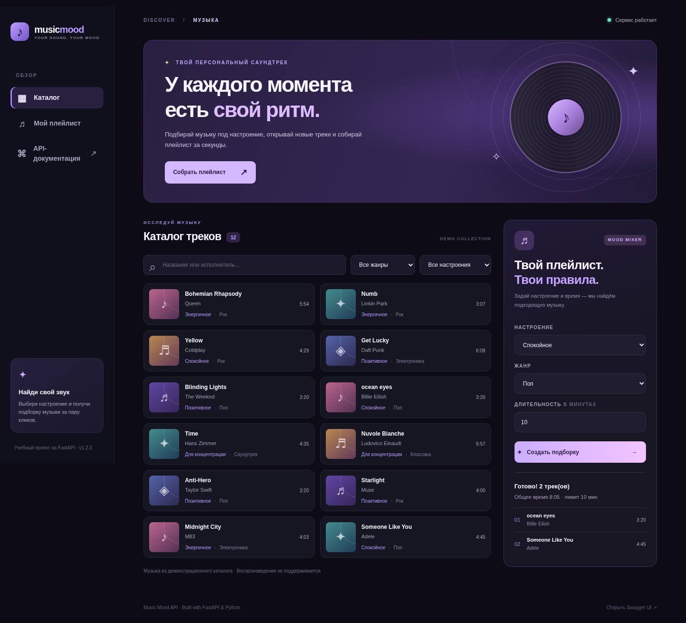
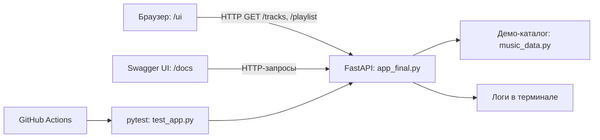

<div align="center">

# 🎧 Music Mood API

**Музыкальный каталог, плейлисты под настроение и собственный веб-интерфейс на FastAPI**

[](https://github.com/NikDiNozzo/music-mood-api/actions/workflows/ci.yml)


**[Веб-интерфейс](#быстрый-старт) · [API-документация](#api-и-примеры-запросов) · [Тесты и-ci](#тестирование-и-ci) · [Диагностика](#диагностика)**

</div>



> **Статус:** учебный демонстрационный проект. Работает локально, без регистрации, внешних музыкальных API и базы данных. Треки не воспроизводятся — приложение показывает каталог и формирует подборки.

## О проекте

Music Mood API помогает найти композиции по исполнителю, названию, жанру или настроению, а затем составить плейлист, который не превышает заданную длительность. Пользоваться можно двумя способами: через **визуальную страницу** с карточками и фильтрами или через **REST API** и интерактивную документацию Swagger UI.

Это итоговый проект по дисциплине «Инфраструктура и администрирование»: цель — показать весь путь небольшого сервиса от кода и Git до тестов, CI, воспроизводимого запуска и диагностики.

**Возможности**

- Каталог из 112 демонстрационных треков с жанрами, настроениями и продолжительностью.
- Поиск по названию и исполнителю; комбинированная фильтрация по жанру и настроению.
- Плейлист по настроению, необязательному жанру и лимиту времени (от 1 до 180 минут).
- **«Мой плейлист»** — отдельная панель с последней созданной подборкой. Она сохраняется в локальном хранилище браузера и доступна после обновления страницы.
- Понятные сообщения, если треки не помещаются в заданное время или все композиции выбранного сочетания жанра и настроения уже включены.
- Порционная загрузка каталога кнопкой «Показать ещё» (по 16 треков), чтобы длинный список оставался удобным.
- Открытая документация `/docs`, проверка доступности `/health`, информация о версии `/version`.
- Настройки через переменные окружения и структурированные сообщения в логах.
- Автоматические тесты pytest и GitHub Actions с публикацией артефакта.

## Быстрый старт

### 1. Требования к системе

| Компонент | Требование / рекомендация |
| --- | --- |
| ОС | macOS, Linux либо Windows 10/11 |
| Python | **3.12 рекомендуется**; исходный код рассчитан на Python 3.10+ |
| Браузер | Современный Chrome, Firefox, Safari или Edge с включённым JavaScript |
| Сеть | Требуется **однократно для установки** Python-зависимостей; само приложение не обращается к сторонним API |
| Оборудование | Обычный ноутбук или ПК; выделенный сервер и GPU не нужны |

> Точные минимальные значения RAM/CPU не измерялись. Для локальной демонстрации разумно иметь несколько сотен МБ свободного дискового пространства для виртуального окружения и установленных библиотек; это **ориентир, а не результат нагрузочного тестирования**.

### 2. Установка

Клонируйте проект и перейдите в его каталог:

```bash
git clone https://github.com/NikDiNozzo/music-mood-api.git
cd music-mood-api
```

**macOS / Linux**

```bash
python3 -m venv .venv
source .venv/bin/activate
python -m pip install -r requirements-dev.txt
cp .env.example .env
```

**Windows (PowerShell)**

```powershell
py -m venv .venv
.venv\Scripts\Activate.ps1
python -m pip install -r requirements-dev.txt
Copy-Item .env.example .env
```

Для запуска без тестов можно установить только `requirements.txt`. Если PowerShell запрещает активацию скриптов, используйте `.venv\Scripts\python.exe` вместо `python` в командах ниже.

### 3. Запуск

Для разработки, с автоматической перезагрузкой:

```bash
python -m uvicorn app_final:app --reload
```

Для обычного локального запуска **без `--reload`**:

```bash
python -m uvicorn app_final:app --host 127.0.0.1 --port 8000
```

| Адрес | Назначение |
| --- | --- |
| **http://127.0.0.1:8000/ui** | 🎵 **Визуальный каталог и генератор плейлистов** |
| http://127.0.0.1:8000/docs | Swagger UI — техническая документация REST API |
| http://127.0.0.1:8000/ | JSON с информацией о сервисе и ссылками |
| http://127.0.0.1:8000/health | Диагностика доступности |
| http://127.0.0.1:8000/version | Текущая версия |

Остановить сервер: `Ctrl+C` в терминале. Веб-страница использует те же API-маршруты, что перечислены ниже; отдельный фронтенд-сервер не нужен.

## Как пользоваться

**Через интерфейс `/ui`:** задайте запрос в строке поиска, отфильтруйте каталог; справа выберите настроение, жанр и длительность, затем нажмите **«Создать подборку»**. Вы увидите названия композиций, исполнителей и суммарную продолжительность. В левом меню **«Мой плейлист»** открывается панель последней подборки. Она сохраняется в `localStorage` текущего браузера: после обновления страницы список останется, но **не будет синхронизироваться с другими устройствами**. Новая подборка заменяет предыдущую.

Если комбинация жанра, настроения и длительности не даёт результатов, интерфейс показывает предупреждение рядом с кнопкой генерации. Если выбранный каталог закончился раньше заданного времени, появляется объяснение и совет выбрать другой жанр или «Любой жанр». При создании длинных плейлистов **без ограничения жанра** доступно достаточно композиций даже для 50 минут. В каталоге сначала показываются 16 карточек, остальные — по кнопке «Показать ещё». Сервис не воспроизводит аудиозаписи.

**Через API:** отправляйте обычные GET-запросы. Параметры можно задавать в Swagger UI: раскройте маршрут → **Try it out** → **Execute**.

## API и примеры запросов

| Метод | Маршрут | Что возвращает |
| --- | --- | --- |
| `GET` | `/health` | `{"status":"ok"}` |
| `GET` | `/version` | `{"version":"1.3.0"}` |
| `GET` | `/info` | Имя приложения и автора из настроек |
| `GET` | `/tracks` | Все треки; параметры `q`, `genre`, `mood` необязательны |
| `GET` | `/tracks/{track_id}` | Один трек по числовому ID |
| `GET` | `/genres` | Жанры и число треков каждого жанра |
| `GET` | `/moods` | Настроения и число треков каждого настроения |
| `GET` | `/playlist` | Плейлист; обязательный `mood`, необязательные `genre`, `max_minutes` |

```bash
# Статус сервиса
curl http://127.0.0.1:8000/health

# Поиск по исполнителю
curl "http://127.0.0.1:8000/tracks?q=queen"

# Спокойная поп-музыка на 10 минут
curl "http://127.0.0.1:8000/playlist?mood=calm&genre=pop&max_minutes=10"
```

Пример ответа `/playlist?mood=calm&genre=pop&max_minutes=10` (для встроенного каталога):

```json
{
  "mood": "calm",
  "genre": "pop",
  "max_minutes": 10,
  "total_seconds": 485,
  "track_count": 2,
  "tracks": [
    {"id": 6, "title": "ocean eyes", "artist": "Billie Eilish", "genre": "pop", "mood": "calm", "duration_seconds": 200},
    {"id": 12, "title": "Someone Like You", "artist": "Adele", "genre": "pop", "mood": "calm", "duration_seconds": 285}
  ]
}
```

**Правила обработки запросов:** поиск не чувствителен к регистру и крайним пробелам. Неизвестный ID или настроение/жанр плейлиста → HTTP `404`. Некорректные параметры (например, `max_minutes=0` или поиск из пробелов) → HTTP `422`. Отсутствие подходящих треков → HTTP `200` с пустым списком и пояснением. Ответ плейлиста дополнительно содержит `available_count`, `available_seconds`, `unused_seconds`; если выбраны все доступные треки, но указанное время не заполнено, возвращается `notice`.

**Алгоритм:** из каталога в исходном порядке выбираются треки с нужными параметрами, если они полностью помещаются в остающееся время. Это простой детерминированный алгоритм, **не ИИ-рекомендации и не оптимизатор продолжительности**. Длительности в демо-каталоге приблизительные.

## Структура и архитектура

```text
.
├── app_final.py                 # FastAPI: маршруты, конфигурация и логи
├── music_data.py                # Встроенный каталог 112 треков
├── static/
│   ├── index.html               # Пользовательский интерфейс /ui
│   ├── styles.css               # Адаптивное оформление
│   └── app.js                   # Запросы к REST API и отображение данных
├── docs/preview.png            # Иллюстрация интерфейса для README
├── test_app.py                  # Автоматические тесты pytest
├── requirements.txt            # Зависимости приложения
├── requirements-dev.txt        # Дополнительные зависимости тестов
├── .env.example                # Публичный пример конфигурации
├── .gitignore                  # Исключения для Git
├── .github/workflows/ci.yml    # Автоматическое тестирование и artifact
└── README.md
```



Серверное хранилище данных, авторизация, синхронизация плейлистов между устройствами и аудиоплеер **не реализованы** — это осознанное ограничение небольшого учебного проекта. В `localStorage` браузера хранится только **последняя** созданная подборка, без аудио и персональных данных.

## Конфигурация и безопасность

Настройки читаются через `python-dotenv`: скопируйте `.env.example` в `.env` (или используйте переменные окружения ОС).

| Переменная | По умолчанию | Назначение |
| --- | --- | --- |
| `APP_NAME` | `Music Mood API` | Название приложения |
| `APP_AUTHOR` | `Никита` | Автор в `/info` |
| `DEFAULT_PLAYLIST_MINUTES` | `15` | Лимит по умолчанию, 1–180 минут |
| `LOG_LEVEL` | `INFO` | Уровень логов (`DEBUG`, `INFO`, `WARNING` и др.) |

Если лимит некорректен, используется безопасное значение 15 минут и пишется предупреждение. **Не публикуйте реальные `.env`, токены и пароли**: `.gitignore` исключает эти данные, а `.env.example` содержит только образец.

Для локальной разработки сервер слушает `127.0.0.1` и не доступен внешней сети. Не открывайте его публично без дополнительных мер безопасности.

## Тестирование и CI

Запуск локальных тестов из корня проекта:

```bash
python -m pytest -v
```

Тестируются технические маршруты, каталог, комбинации фильтров, ошибки `404/422`, генерация длинного плейлиста, сообщения о нехватке треков, конфигурация и наличие элементов HTML/CSS/JS. Для тестов используется `TestClient` — внешний сервер запускать не нужно.

**GitHub Actions** (`.github/workflows/ci.yml`): при `push` и `pull_request` запускает Ubuntu + Python 3.12, устанавливает зависимости, выполняет тесты и **только после их успешного завершения** публикует `music-mood-api` с исходниками и файлами интерфейса. Последние запуски: [Actions](https://github.com/NikDiNozzo/music-mood-api/actions). Артефакт хранится **7 дней**.

## Диагностика

Все логи выводятся в терминал `uvicorn`: запуск, завершение работы, HTTP-метод, путь, код ответа, результаты поиска и формирование плейлиста.

```bash
curl http://127.0.0.1:8000/health
curl http://127.0.0.1:8000/version
```

| Проблема | Решение |
| --- | --- |
| `Address already in use` | Остановите старый `uvicorn` через `Ctrl+C` или запустите с `--port 8001`; затем открывайте `/ui` на порту 8001. |
| `ModuleNotFoundError` | Активируйте `.venv` и переустановите зависимости. |
| `python: command not found` | На macOS сначала проверьте `python3 --version`, создайте и активируйте окружение. |
| `/ui` открывается, но каталог пуст | Проверьте в браузере `/tracks`, консоль разработчика и лог сервера; для работы интерфейса нужен JavaScript. |
| HTTP `404` или `422` | Проверьте ID, жанр, настроение и значения параметров запроса. |
| Правка `.env` не сработала | Перезапустите сервер. |
| Красный CI / нет артефакта | GitHub → **Actions** → откройте упавший шаг. Артефакт создаётся только после успешных тестов. |

## Назначение и история

Итоговая работа по дисциплине **«Инфраструктура и администрирование»**. Проект развивается на основе учебного FastAPI-примера: история изменений сохранена в коммитах Git. Версия 1.3 расширяет коллекцию до 112 треков, добавляет работающий раздел «Мой плейлист», сохранение последней подборки в браузере и заметные сообщения о пустых или ограниченных результатах, сохраняя REST API и Swagger UI.

_© 2026. Демонстрационный учебный проект, не связанный с перечисленными исполнителями или стриминговыми платформами._
